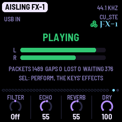
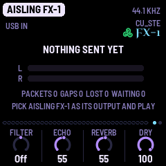
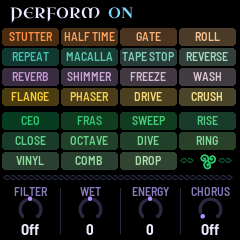

# AISLING FX-1

AISLING FX-1 turns an M-VAVE FM-1 into an effects box for a computer. Connect the FM-1 to the computer with a USB
cable and choose it as the computer's sound output: whatever the computer plays (a song, a track in your music
software, a browser tab) comes in over the cable, goes through AISLING's filter, its echo and its plate reverb and the
effects on its keys, and comes out of the FM-1's 3.5 mm socket. The same sound goes back up the cable too, so the
computer can record it. It is AISLING with its voices taken out: no harps, no drone, no flute, only what the computer
sends.

**Status.** 1.0, the first release. FX-1 has run on one FM-1 and played a computer's sound cleanly through its
effects; it has gone on over AISLING and over the stock firmware, and AISLING back over it; what each control does was
measured in AISLING's simulator (see [What has been tried](#8-what-has-been-tried)). Its package is on
[the 1.0 release](https://github.com/stephencummins/fx1-aisling/releases/tag/v1.0), and it installs from Chrome or Edge
on [its install page](https://aisling.stephen8n.com/fx1/install/) (new: FX-1 has so far gone on from the command line).

AISLING FX-1 is by CU_STE ([www.stephen8n.com](https://www.stephen8n.com)), from AISLING's own source, in a repository
of its own: [github.com/stephencummins/fx1-aisling](https://github.com/stephencummins/fx1-aisling). GPL-3.0. It is
not affiliated with M-VAVE.

, running AISLING FX-1: the dimmed controls and keys change nothing in the computer's sound")

---

## Contents

1. Putting it on the FM-1
2. Setting it up with a computer
3. The controls
4. The screen
5. The effects
6. Saving
7. MIDI
8. What has been tried
9. Going back to AISLING

---

## 1. Putting it on the FM-1

It goes on over AISLING, over another firmware or over the stock one, in either of two ways.

**From Chrome or Edge**, on [FX-1's install page](https://aisling.stephen8n.com/fx1/install/): connect the FM-1 to the
computer with a USB data cable, press Install, allow the page to use MIDI devices, and leave the cable in until it says
Done. It is AISLING's web installer with FX-1's package; FX-1 has not yet been put on with it, only from the command
line.

**From the command line**: download `aislingfx-1.0.fwsc` from
[the 1.0 release](https://github.com/stephencummins/fx1-aisling/releases/tag/v1.0) and put it on with the installer in
the source, which needs Python 3 with mido and python-rtmidi. Connect the FM-1 by USB first:

```
git clone https://github.com/stephencummins/fx1-aisling
pip3 install mido python-rtmidi
python3 fx1-aisling/tools/fm1_install.py aislingfx-1.0.fwsc
```

To build it yourself, the toolchain is AISLING's (see
[BUILDING.md](https://github.com/stephencummins/fx1-aisling/blob/main/BUILDING.md)), with one flag: in the clone,
`./build.sh --fx` makes `build/aislingfx-dev.fwsc`, and `./build.sh --release 1.0 --fx` makes 1.0.

The FM-1 then starts as **AISLING FX-1**: the launch screen says so, and so does its name over USB. Its identity is
its own, FM-1_391 and six digits (F, X and 1 on a phone's keys: 1.0 is FM-1_391010000, and a build that is not a
release FM-1_391000000), so The Firmware Hub and AISLING's web installer don't take it for AISLING. Without `--fx`
the same source builds AISLING.

## 2. Setting it up with a computer

1. Connect the FM-1's USB-C socket to the computer with a data cable. With a cable that only charges, the screen
   stays at NO COMPUTER.
2. The computer finds a USB sound device called **AISLING FX-1 FM-1**, with an output (to the FM-1) and an input
   (from it). It needs no driver: it is a standard USB audio device, as AISLING's recording stream is.
3. Choose it as the computer's sound output, or as the output of one track in your music software, and play
   something. The screen goes from NOTHING SENT YET to OPEN, NO PACKETS when the computer opens the stream, and to
   PLAYING when the sound arrives.
4. Listen at the FM-1's 3.5 mm socket, on headphones or into a mixer. MASTER sets the level there.
5. To record what comes out, choose the FM-1 as the computer's input too. That stream is at a fixed level, before
   MASTER: the computer sets its volume.

The stream is 44.1 kHz, 16-bit, stereo, the only rate it offers, so the computer converts to it where it must. The
FM-1 keeps time with the computer's clock: it watches how full its buffer is and resamples a little faster or slower
to match, so two clocks that disagree slightly make no clicks.

## 3. The controls

At HOME the four knobs are FX-1's own: the filter, the two sends and the dry. The rest are AISLING's, acting on the
computer's sound where AISLING's acted on its voices. A piece still sits underneath, unheard: its echo and reverb
amounts, its echo's feedback and its tempo are where FX-1 starts, and PRESETS changes them all at once. The voices'
pages are still there too, but with no voices they change nothing you can hear.

| Control | What it does |
|---|---|
| MASTER | The level at the 3.5 mm socket. The stream back to the computer doesn't follow it |
| KNOB 1 at HOME | **Filter**, on the whole sound: Off in the middle. Turned down it shuts, a low-pass, to about 200 Hz at the end; turned up it opens, a high-pass, to about 800 Hz. It drifts a little by itself while the FM-1 plays (see PLAY) |
| KNOB 2 at HOME | **Echo**: how much of the sound goes into the echo. The same Echo as the Space page's, and saved with the piece |
| KNOB 3 at HOME | **Reverb**: how much goes into the plate reverb; 0, none. The Space page's Reverb, saved with the piece |
| KNOB 4 at HOME | **Dry**: how much of the sound itself goes straight out, 0 to 100. The echo and the plate are fed the same whatever it says, so at 0 only they are heard (for a send and return). Not saved: 100 at every start |
| PRESETS | The piece underneath: its echo and reverb amounts, its feedback, its plate's size and its tempo, which the echo's time counts in (at the same Echo time, Skellig's repeats come 1.2 s apart, Aran's 0.95 s) |
| SELECT, ALGORITHM | On the voices' pages, a layer's level and its voice: nothing to hear. On the Setup page, as in AISLING, the journey's stay and the sleep timer (see [Saving](#6-saving) on sleep) |
| OCT− / OCT+ | A layer's octave: nothing to hear. With HOME held, undo and redo |
| SEL | A tap: PERFORM, the keys' effects (see [The effects](#5-the-effects)); another tap: back |
| FX | The Space page: Echo, Echo time (six steps, an eighth to a whole bar, in the piece's beats), Feedback (in seconds of tail: 0 is a single repeat; at 100 each repeat is about 13 dB under the last, and it never runs away), Reverb. Again, the Echo page: Blur, Tone (lower is darker), Width (0: the echo in mono), Size (the plate's length) |
| GLO | The Setup page: Tune and Lights (nothing to hear), MIDI out, Save. Held half a second: save |
| HOME | The HOME page; again, the Key page, whose Tempo is the beat the echo's time counts in (Root, Mode and Transpose change nothing here) |
| PLAY | Play / rest. The sound comes through either way. Playing, the Filter and the echo's Wet drift slowly by themselves, as AISLING's do (a turn of yours holds until the next section); at rest they keep still |
| REC | A tap: hold. The echo and the plate keep what they have and go on repeating it, while the sound still comes through dry. Held: the effects grid on the white keys |
| White keys | Nothing (they play the Lead, and FX-1 has none). With REC held, the grid's effects; in PERFORM, effects |
| Black keys | An effect each, while held: Shimmer, Freeze, Macalla and Fras work here (see [The effects](#5-the-effects)) |
| ENV, ARP, LFO, SEQ, SAVE, EDIT | The voices' pages: nothing to hear. SAVE held half a second still saves |

## 4. The screen



On every page but PERFORM's, the middle of the screen is the sound coming in. The header says AISLING FX-1 and the
stream's rate, 44.1 KHZ.

- **The state**, large: NO COMPUTER (no USB, a cable that only charges, or the computer asleep), NOTHING SENT YET (a
  computer is there, but hasn't opened the stream: the FM-1 isn't its output yet), OPEN, NO PACKETS (it has opened
  the stream, and no sound has come yet), PLAYING. The line under the counts says what to do next.
- **L and R**, the level coming in, over 40 dB. The bar turns red at full scale: turn the computer down a little.
- **The counts**: PACKETS, the packets that have come in; GAPS, the times the buffer ran dry when the effects wanted
  sound; LOST, packets that arrived with the buffer full; WAITING, the fewest frames the buffer has held lately (the
  FM-1 steers it to about 376, under a hundredth of a second). GAPS and LOST should stay at 0, and the line turns
  orange if they don't. ODD PACKETS, in red, counts packets that weren't a whole number of frames.

These tell a stream that won't start from one that isn't being sent: stuck at NOTHING SENT YET, the computer's sound
is going somewhere else; stuck at OPEN, NO PACKETS, the computer opened the stream and sends nothing. For two seconds
after a button, the page's name covers the state.



## 5. The effects

The sound goes straight out at the Dry knob's level, and the same sound, both sides mixed, goes into the echo and the
reverb at the Echo and Reverb knobs' levels. At a piece's own settings the echo is quiet, about a twentieth of the
dry: turn Echo up, or Dry down, to hear it, and the keys that work through the echo (Macalla) with it.

Every key's effect is AISLING's, and lasts as long as the key is held. Some were made for AISLING's voices, and with
no voices they change nothing. Measured in the simulator, these
are the ones that change the computer's sound:

| Where | Effects that work | Effects that change nothing |
|---|---|---|
| Black keys | Shimmer (an octave up, in a wash), Freeze (a cloud of grains that holds after the sound stops), Macalla (a long echo, with Echo up), Fras (its own bleeps, even with nothing coming in) | Ceo, Repeat, Octave, Return, Rise, Close, Transpose |
| REC held, the white keys (the grid) | Time, Tape stop (slight), Shimmer, Low-pass (mild), High-pass, Phaser, Reverb, Freeze, Wash, Fras (bleeps), Macalla (slight) | Repeat, Sweep, Ceo, Octave, Return |
| PERFORM (SEL), all 27 keys | Stutter, Gate, Reverse, Macalla (slight), Tape stop (slight), Reverb, Shimmer, Freeze, Wash, Flange, Phaser, Drive, Crush, Ring, Vinyl (crackle and a wobble), Comb, Fras (bleeps) | Half time, Roll, Repeat, Ceo, Sweep, Rise, Close, Octave, Dive, Drop |



PERFORM's knobs: **Filter** is HOME's Filter; **Wet** turns up the echo's send, a little; **Chorus** thickens and
widens the whole sound; **Energy** changes nothing here. On the Journey page (GLO a third time), the Day setting
adds a slow drift to the echo and, now and then, Fras's bleeps.

## 6. Saving

AISLING saves by itself when it rests; FX-1 always counts as playing, so it doesn't. To keep your settings, hold GLO
(or SAVE) for half a second, or turn Setup's Save.

- **Saved**: the Echo and the Reverb, the Space and Echo pages (Echo time, Feedback, Blur, Tone, Width, Size), MIDI
  out, Lights, and the piece.
- **Not saved**: the Filter, PERFORM's Wet, Energy and Chorus, the sleep timer and the Day. The Dry knob is 100 at
  every start.

**Where it saves.** FX-1 is AISLING underneath, so it saves where AISLING does, in AISLING's own format: one save
holding the eight pieces and the settings. It reads what AISLING saved, and starts on the piece AISLING was playing,
with that piece's echo and reverb; a save in FX-1 stores its settings as the piece's, as a save in AISLING does, so
AISLING then plays that piece with them. It doesn't read what NACHTFAHRT, DUB-1 or AMB-1 saved (with their saves it starts on AISLING's own recipes),
and they save in the same place in the FM-1's memory, so a save in FX-1 replaces theirs, and theirs replaces FX-1's.
Installing another firmware may lose what FX-1 saved. FX-1 uses no samples.

**Sleep.** Setup's sleep timer (ALGORITHM there; off unless you set it) fades the socket after the time you choose,
even with the computer's sound still coming in, and the sound coming in doesn't wake it: a touch does. The stream
back to the computer goes on. If you use FX-1 for long stretches without touching it, leave the timer off.

## 7. MIDI

FX-1 sends no notes and no clock: there is nothing playing to send them for. While Setup's MIDI out is on, an effect
you play sends its control change on channel 16, 127 as it starts and 0 as it ends, as AISLING's do, so music
software can record a performance and play it back.

What comes in is as in AISLING (its manual's [MIDI](https://aisling.stephen8n.com/manual/#s11) has the numbers), so
music software can play FX-1 along with a track: CC 74 turns the Filter, CC 16 to 19 the four knobs of the page on
the screen (at HOME, Filter, Echo, Reverb and Dry), CC 78 and 80 PERFORM's Wet and Chorus, and each effect's own CC
holds it on, 127, and lets it go, 0. A program change chooses a piece, and with it the echo's and the reverb's
settings.

## 8. What has been tried

**On an FM-1** (one, with the first flash chip), with a Mac playing through it:

- The sound plays: PLAYING, with GAPS 0 and LOST 0, the buffer holding about 370 frames.
- It sounds right, and the screen keeps up with no lag.
- Turning Dry down leaves the effects as they were.
- Installing, with `tools/fm1_install.py`: the 1.0 package (the one on the release) over AISLING 1.4, AISLING 1.4 back over 1.0, and 1.0 over the stock
  firmware (V16). Each time FX-1 went on, a tone sent down the cable came back up it through the effects.
- AISLING's saved pieces after going to FX-1 and back, with no save in FX-1: as they were, byte for byte, all eight
  loading.

**In the simulator** (the whole app run on a computer, fed a tone, bursts and noise, each change measured against
the same run without it): every control and key above, the saving, and the sleep timer.

**Not yet:**

- How late the sound comes out of the socket (the latency).
- A long session on the FM-1, and more than one kind of computer.
- The keys' effects on music, by ear, on the FM-1.
- A save in FX-1 on the FM-1, then AISLING reading it (the source says it takes FX-1's settings as the piece's).
- A newer FM-1 (the second flash chip), and installing over the stock V15.
- Installing from [the install page](https://aisling.stephen8n.com/fx1/install/) (it does what `tools/fm1_install.py`
  does, and is how AISLING is installed).

## 9. Going back to AISLING

Install AISLING over FX-1 as over any firmware: from Chrome or Edge with the
[web installer](https://aisling.stephen8n.com/install/), or with `tools/fm1_install.py` and a release package
(tried: AISLING 1.4 over FX-1 1.0, its saved pieces as they were). To go back to the stock firmware, see
[Back to stock](https://aisling.stephen8n.com/install/#stock).
