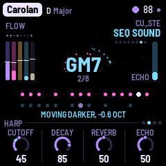
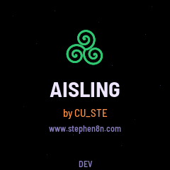
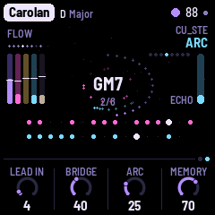
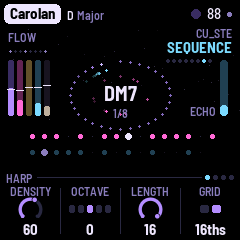
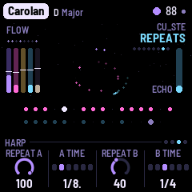
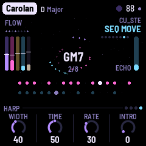
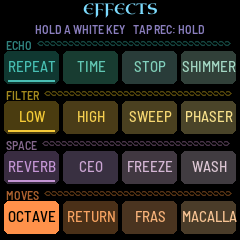
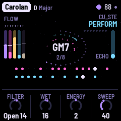

# AISLING

AISLING turns the M-VAVE FM-1 into a generative Irish ambient instrument: harps over a held drone, and a flute, a
fiddle or a voice leading, in the old modes, with the weather of the west coast behind them. It plays
itself from the moment it's switched on. A harp's ostinato runs over the drone, often in a jig's threes, its notes
repeated by the echo; a second harp, a step shorter and an octave down, drifts against it like the harper's other
hand; the Lead plays long phrases far back in the reverb; surf, wind, rain, a turf fire or a curlew pass behind. The chords
swing between two tonics, D and C or E minor and D, as the old tunes do. Each piece opens from the drone, flows,
gives the Lead its turn, crosses a bridge, and goes on for ever; every layer's filter moves slowly on its own.
Listen, and play: let it run, or join in. Play a melody on the white keys and the Lead answers it, takes it as its
theme and grows new ideas out of it; pick a piece and a key, thin or fill the harps, open the filter, push the
echo, or tap SEL and play the effects on the whole music.

Source, releases and the web installer: [github.com/stephencummins/fm1-aisling](https://github.com/stephencummins/fm1-aisling)
and [aisling.stephen8n.com](https://aisling.stephen8n.com/). AISLING is by CU_STE
([www.stephen8n.com](https://www.stephen8n.com)).

AISLING is said ASH-ling. It's Irish for a dream or a vision (an *aisling* is also an old kind of Irish poem, a
vision), and a pun on *AI Synth Link*; [Saying the names](#saying-the-names) has the rest. It is a fork of [NACHTFAHRT](https://github.com/FartyPants/fm1-nachtfahrt)
by FartyPants, a Berlin School firmware: it keeps NACHTFAHRT's whole machine and changes what it plays. NACHTFAHRT
is a fork of DUB-1, itself a fork of AMB-1, Charles Vestal's generative ambient firmware for the FM-1.

**This is 1.3.1:** PERFORM is all effects, twelve of them new, with Chorus and a CC for each (1.3), and the effects grid redrawn to match. It runs
on the FM-1 (install it from the web installer) and in the browser emulator, from the same code.

, running AISLING, each control labelled")

---

## Contents

1. Install
2. Getting started
3. Controls
4. The screen
5. The layers
6. The arc and the filter motion
7. The pieces
8. The pages
9. The effects grid
10. PERFORM
11. MIDI
12. Saving
13. Troubleshooting
14. Credits

---

## 1. Install

**Try it first in the emulator.** It is the same code the FM-1 runs, with sound, in a browser. Build it
with `web/emu/build.sh`, serve `build/emu` (for example `python3 -m http.server --directory build/emu`) and
open the page. [EMULATOR.md](../EMULATOR.md) has the details.

**On the FM-1** (once there is a device build): `./build.sh` makes `build/amb.fwsc`; install it with

```
python3 tools/fm1_install.py build/amb.fwsc
```

(Python 3 with `pip3 install mido python-rtmidi`, the FM-1 connected by a USB data cable and switched on.)
Don't unplug it while it's writing; when it finishes, the FM-1 restarts into AISLING. The stock firmware goes back
only in the version whose bootloader your FM-1 already has: V16 with M-VAVE's own updater, M-UPGRADE, or V15 with
The Firmware Hub (see [Installing over AISLING](#13-troubleshooting)). M-UPGRADE may show AISLING with an odd version
number; that's expected.

> Installing other firmware is at your own risk. If the FM-1 ever won't start, see
> [Recovering an FM-1 that won't start](#recovering-an-fm-1-that-wont-start).

---

## 2. Getting started

AISLING starts playing as soon as it's on. A few minutes with it:

1. **Listen.** The first piece, Skellig (D minor, 76), begins with its drone, the pipes' drones on D, and the surf.
   Its harp is there from the start, twelve notes with every third accented (a jig's lilt), behind a closed
   filter that opens over the first 8 bars (about 25 seconds). Then the harp runs, its notes repeated by the
   echo, and within the first minute the flute comes in. Nothing is hidden: no layer is turned down behind your back, only filters move. Turn
   MASTER for the volume.
2. **Try another piece.** Turn PRESETS. Each of the eight has its own key, tempo, voices, sequences and
   arc. Aran and Carolan start their strings at once (Aran's a bouzouki over a bodhrán); Skellig, Samhain and
   Connemara have one harp only (Samhain's over a bodhrán's heartbeat, Connemara's over a low bodhrán), and in Samhain even the drone opens slowly out of
   the dark.
3. **Play the lead.** Press a white key: the lead plays that step of the scale, from the root up, and its
   key lights while it sounds. It glides from note to note, deep in the reverb and the echo. Play three notes or more
   and pause: the lead takes them as its theme, answers you a beat or two later in your rhythm, and brings your
   notes back later. The black keys stay lit: they play effects while you hold them, dark while held (Rise opens every filter, Close shuts them, and so on: see [The effects grid](#9-the-effects-grid)).
4. **Shape the sequence.** Press ARP: the Sequence page. KNOB 1 (Density) thins it out or fills it in;
   KNOB 3 (Length) makes it shorter or longer. Press ARP again for its sound (Cutoff opens the filter), and
   again for its **Repeats**: the notes the echo plays back, as loud as the note itself. One press more:
   its **Move** page, how its filter wanders around the Cutoff you set.
5. **Hold the echo.** Tap REC: the echo stops listening and repeats what it holds while the music goes
   on dry above it. Tap REC again to let it go. Hold REC: the effects grid, sixteen effects on the white
   keys, each one there while its key is held.
6. **Perform.** Tap SEL: every key is an effect while you hold it, several together. Hold some and tap REC and
   they stay on; REC alone lets them go.
7. **Watch the filters.** On a layer's sound page, a small cyan dot on the brightness knob's ring shows where
   the filter is now, and the screen says how far it has moved ("MOVING DARKER, -1.5 OCT"). Turn the knob:
   the movement goes on around its new setting.
8. **Rest.** Press PLAY: the music stops and the echo and reverb ring away. PLAY again and the piece opens
   again from the top.

What you change is kept with the piece. AISLING saves it by itself while resting; or hold GLO for half a
second.

---

## 3. Controls

| Control | What it does |
|---|---|
| MASTER | The volume, with room at the quiet end: a low listening level sits about a quarter of the way up. The USB audio doesn't follow it: there, the computer sets the volume |
| SELECT | On a layer's pages (the Drone, the Sequence, the Lead, Sequence 2, the Atmosphere, and each one's further pages), the layer's level, 1 a click: a ring in the middle of the screen shows it, and the header says it ("SEQ 64"). On the Aisling page it turns **Energy**, PERFORM's (the same value, 1 a click: the screen shows twice), so you can play the keys and push Energy at once: the knobs' rule shows "ENERGY 24" with a bar while you turn, and the header says it. Elsewhere it does nothing (the pages are on their buttons, the tempo on the Key page) |
| PRESETS | The piece (eight) |
| ALGORITHM | On a layer's page, its voice (on the Atmosphere's pages, its character). On the Chords page, the chord walk's character (Home, Wander, Free). On the Aisling page, Evolve's timing (see Nudges, below). On the Setup page, the sleep timer (see Sleep, below) |
| OCT− / OCT+ | On the Sequence's, the Lead's and Sequence 2's pages, the layer's octave, a step a press (the Sequence −2 to 2, the Lead and Sequence 2 −2 to 1): the page's Octave knob shows it, the header says it ("SEQ OCTAVE −1"). OCT+ is lit while that octave is above where the piece was loaded, OCT− while it's below. On the other pages they do nothing. With HOME held, OCT− undoes and OCT+ redoes (see Undo, below). Both held 5 s: the update mode |
| KNOB 1–4 | The four values at the bottom of the page. The line above them says what the one turning does |
| White keys | Play the Lead in the piece's scale: the first white key is the root, the next the scale's second step, and so on up. While the Lead sounds a note, that key is lit. Three notes or more and a pause become the Lead's theme (see [The layers](#5-the-layers)). On the Pattern page they write the steps instead; in PERFORM they mute, play moves, and the top one makes the Lead forget; with REC held they're the effects |
| Black keys | Eleven effects, each while the key is held. They stay lit, so they stand apart from the Lead's white keys; a key goes dark while its effect is held: Ceo, Macalla, Fras, Repeat, Shimmer, Freeze, Octave, Return, Rise, Close, Transpose (see [The effects grid](#9-the-effects-grid)). In PERFORM, its own eleven; on the Pattern page, the accents |
| PLAY | Play / rest |
| REC | A tap: hold (the echo and the cloud repeat what they hold). Held: the effects grid |
| EDIT | A tap: the Chords page. Held: the next chord, on the next bar. Held on (1.5 s): new chords |
| SEL | A tap: PERFORM; another tap: back to the page you came from. Held: **Lock** (the sequences stop varying, each pass as the last, until SEL is held again; not saved) |
| HOME | The Aisling page; again, the Key page. Held on (1.5 s): a shake of every layer. Held, with OCT− or OCT+: undo or redo |
| ENV | The Drone; again, its sound page; again, its Move page |
| ARP | The Sequence; again, its sound page; again, its Repeats; again, its Move page |
| LFO | The Lead; again, its sound page; again, its style page; again, its Move page |
| SEQ | Sequence 2; again, its sound page; again, the Pattern page; again, its Move page |
| SAVE | The Atmosphere; again, its sound page; again, its Move page. Held half a second: save |
| FX | The Space page; again, the Echo page |
| GLO | The Setup page; again, the Arc page (Lead in, Bridge, Arc, Memory). Held half a second: save. Held on (1.5 s): the piece back to its recipe |

**Nudges.** Hold a layer's button (ENV, ARP, LFO, SEQ) for half a second: its sound takes a small step
somewhere new (its filter, envelope, tone or vibrato, never its sends or octave). Hold it on for 1.5 s: a
shake, a new voice and bigger steps. HOME held on shakes every layer at once. Each step is pulled back
towards the piece's recipe, so nudges explore around the piece's sound rather than wander off. With Evolve
over 40, AISLING nudges a layer by itself now and then. The Atmosphere has no nudge of its own, because SAVE held
saves; Evolve and HOME's shake still move it.

**Evolve's timing.** On the Aisling page, ALGORITHM sets when Evolve's nudges land: **now and then** (at the start of
a phrase, more often the higher Evolve is; as before 1.2), or **every 4, 8, 16 or 32 bars**, every time, a step a
click. The bars are counted from the top: from when the music starts, or from a DAW's start under MIDI clock. The
start of the knobs' rule shows it ("EVOLVE EVERY 8 BARS"), lit while Evolve is over 40; at 40 and under nothing moves
either way, and Lock stops it as before. It's saved, one setting for every piece, as Tune is. The sequences' own small
changes, the other half of Evolve, keep their own times.

**Undo.** Hold HOME and tap OCT−: the piece's settings go back a step. OCT+ brings them forward again. While HOME is
held, OCT− is lit if there's something to undo and OCT+ if there's something to redo. Undo goes back 16 steps, and
changes less than a second apart count as one step. It takes back knobs, voices, nudges, shakes and a reset to the
recipe. What Evolve moves makes no step of its own, but an undo rolls it back with the rest. Undo covers the settings
and the scale, not the patterns: after undoing a reset, the settings return but the patterns it grew stay. Tune, MIDI
out and Lights aren't undone, and in Endless the chords aren't, because the walk moves them itself. Another piece
clears undo, and it isn't saved, though the piece it leaves behind is, as after any change.

**Sleep.** On GLO's Setup page, ALGORITHM sets a sleep timer: Off, 15 or 30 minutes, 1, 2, 4 or 8 hours, a step a
click. The start of the knobs' rule shows it ("SLEEP 30 MIN"). The time runs from the last thing you touched (a
button, a key, a knob, or a note or program change sent in over MIDI), so it never fades out while you play. Over the
last 30 seconds the sound fades out, and a touch then brings it back and starts the time again. At the end the music
stops, as PLAY stops it, the screen goes black (its light still glows faintly) and the button lights go out. A press,
a key or a turn wakes it, and that touch only wakes it: the screen comes back, and the music starts again, faded in,
if it was playing. MIDI doesn't wake it (a sequencer left running would), and MIDI sent while it sleeps is ignored.
The USB audio isn't faded, since it comes before MASTER, but it stops with the music. The timer isn't saved: it's off
every time the FM-1 starts.

A long press says what it did on a card in the middle of the screen.

---

## 4. The screen


The screen is black, with a few dim stars drifting slowly left while the music plays.

- **Top:** the piece, its key and mode, the tempo (EXT under MIDI clock). A dot means unsaved changes.
- **Top left:** the section of the arc (EMERGE, FLOW, SOLO, BRIDGE), with **hold** and **lock** after it in red
  while they're on, and under it the eight bars of the phrase.
- **Top right:** "CU_STE", small, and under it the page's name in an uncial hand (with SOLO beside it while a solo
  is on); on the Aisling page, a small green triskele before it.
- **Left:** five **meters**, one for each layer in its own colour: the Drone (violet), the Sequence (pink), the
  Lead (gold), Sequence 2 (cyan), the Atmosphere (grey). Each rises with what its layer is playing. Across each
  one, a white **tick** shows where that layer's filter has moved to: above the middle, brighter; below,
  darker; six pixels for each octave.
- **Middle:** the chord the Drone plays, its name in white with nothing behind it. Each note of the
  Sequence sends a pink dot round it on the inner orbit, each note of Sequence 2 a cyan one on the outer
  orbit, fading over a few seconds; the echo's repeats are smaller, dimmer dots with a short trail. **Hold**
  turns the chord and the dots red and says "hold". A new chord comes in big and cyan for a moment.
- **The chord's ring:** round the orbits, a ring of violet dots shows how far the chord has gone: it grows
  clockwise from 12 o'clock, bar by bar, and is full when the chord changes, then starts again from 12. In the
  chord's last bar it is brighter, so you can play a phrase into the change. While held (REC) it stays as it
  is, in red; with Drift at Hold (the chord never changes) there is no ring.
- **Right:** the echo's level (ECHO).
- **Which page:** the line above the knobs ends in a dot for each page of the button you're on, with the page you're
  on lit. When a button brings a new page, its name shows large over the chord for a moment, in the same uncial hand, with the same dots.
- **A ring in the middle:** while you turn SELECT on a layer's page, its level as a big knob in its colour, the
  number inside and the layer's name under it (grey and MUTED if it's muted); it fades a moment after.
- **Below:** two **lanes**, the Sequence (pink) and Sequence 2 (cyan), each as long as its sequence: a big dot
  for each step that plays, a speck for a rest, and a white cursor on the step playing now. Two sequences of
  different lengths drift apart and meet again, and you can see them do it. On a layer's page, the other
  lane is greyed.
- **Bottom:** the page's four knobs and their values, under a rule drawn as a plait. While a knob turns, the rule says what it does;
  while SELECT turns Energy on the Aisling page, it shows "ENERGY", its value and a bar from the middle.

**The filter motion, shown.** On a layer's *sound* page (the one with its brightness knob), a small cyan
dot sits on that knob's ring where the filter really is now: the knob's own pointer stays where you set it.
Under the lanes the screen says how far it has moved: "MOVING DARKER, -1.5 OCT" or "MOVING BRIGHTER, +0.8 OCT"
(not shown while it is within a tenth of an octave of the knob). The screen reader says it too ("Cutoff
moving darker, about -1 octave").



**The launch screen.** Every time the FM-1 starts, a green triskele (the triple spiral, as carved at Newgrange)
draws itself on black among a few stars, AISLING comes up large under it, then "by CU_STE" in orange and
www.stephen8n.com, and the version at the foot, for a moment. The music starts as always, under it.



---

## 5. The layers

**The Sequence** (ARP; MIDI channel 2) is the heart: in six of the eight pieces a harp (Aran's a bouzouki, Blasket's a dulcimer). Up to 16 steps in the scale, eighths or sixteenths,
played on a plucked voice: **2600** (a saw), **Moog** (two saws a little apart), **Synthi** (a square),
**Pulse** (a narrow pulse), **Glass** (an FM bell), each through two low-passes, the second resonant,
swept down by a short envelope; or **Harp**, a plucked wire string, as on the old Irish harp (Karplus-Strong: a burst of noise ringing round a
delay line a period long), whose Cutoff is how bright the string is struck and Decay how long it rings (long: a wire string rings on) (in the
highest octaves, from about C7, a string rings short whatever Decay is set to, as a real one does); or **Bouzouki**,
picked pairs of strings a hair apart, beating slowly as a course does, darker and shorter than the Harp; or
**Dulcimer**, hammered pairs, bright, with a short clang at the strike (both ring as the Harp does, Cutoff and Decay
the same; the lowest notes, under about C2, on one string). The
root step is accented and the others quieter (Accent, on the Pattern page). Density decides how many of the steps sound, the least important dropping out first. In Carolan it also drifts, a slow wander about the knob's value, so the harps fill out and thin over a minute or two (Motion sets how far and 0 holds it; so does a knob right up or right down). Now and then
(Evolve, Motion) a step changes, a note moves, an octave jumps, the sequence comes round early; it follows the Drone's chord
(Transpose, on the Key page). Its cutoff wanders slowly over minutes, around the Cutoff you set (its Move page, below; its Width is the
**Sweep**).

**The Repeats** (ARP, third page), NACHTFAHRT's Berlin School echo, kept: each note is played again at one of the echo's
times, by default a dotted eighth (**Repeat A**, as loud as the note: 100), and a second time
(**Repeat B**) into the rests only. They are real notes, so they go through the filter and the echo like the
rest, and the Sequences are sent into the echo generously. The echo's own time is by default a dotted
quarter (1/4.), so Repeat A, a dotted eighth, doesn't land on the echo's first repeat.

**Sequence 2** (SEQ; channel 4) is a second line, by default an octave down and a step shorter (7 against
8), so the two drift apart and come back together. It has the same voices and **Sub** (a sine and its
octave below), and **Bodhran**, the frame drum: each note folded down into the drum's tone (65 to 130 Hz, so the line
plays the drum's patterns), a slap over it (Cutoff 2 how bright), Decay 2 how long the skin sounds; on ALGORITHM,
Harp, Bouzouki, Dulcimer and Bodhran come after Sub. Chance thins it at random. Its **Intro** (Move page) opens its filter, from closed, over that many bars: in Blasket
it comes out of the drone after the Sequence. Motion changes its steps and octave jumps but never its length:
an 8 against a 7 stays 8 against 7. And with **Motion**, at a change of section, Sequence 2 may move an octave up
or down from where its Octave knob is set (at the range's ends, the other way), and back at the next change of
section; never more than one octave away (the chance is Motion's: at 100 every time, at 0 never). Its page's
Octave knob shows where it is, and OCT+ or OCT− lights. Turn its Octave knob or press OCT− / OCT+ on its page and
what you set is its octave again, the move gone; what's saved is always the octave you set.

**The Drone** (ENV; channel 1) holds the chord on two banks of five voices: the chord's four notes and the
root an octave under (the **Pedal**). Voices: **Organ**, **Strings** (through an ensemble), **Pipes** (a piper's chord: each note a soft double reed, and the Pedal three drones, bass, baritone and tenor, an octave apart and a few cents out, so they beat slowly), **Harmonium** (two free-reed ranks, one a few cents sharp, on a slow bellows that swells and brightens them),
**Glass**, **Choir**. The Choir sings a vowel: each note is two voices a little apart, through three formants
(as a voice's mouth shapes it) and the Strings' ensemble. The vowel moves with the Drone's brightness: **Colour**
chooses it ('oo' at −25, 'ah' at 0, 'ee' at +25, 'oh' and 'eh' between; past ±25 it only gets darker or
brighter), and its **Move** page moves it, slowly, as it moves the other voices' filter (two vowels for each
octave the filter moves; the Intro opens it from 'oo'). Its **Reso** makes the formants sharper or softer. A
phaser sweeps it slowly (**Phaser**). The chord walks from degree to degree every **Drift** bars
(the Aisling page), or follows the eight slots of the Chords page.

**The Lead** (LFO; channel 3) is one voice, gliding: **Odyssey**, **Mini**, **Flute**, **Theremin**, **Synthi**,
**Chanter**, **Fiddle**, **Voice**. The **Flute** is a soft tone with a little of its second and third harmonics,
breath, and a chiff as each note starts; the **Chanter** a nasal reed, bright as each note starts, each note stopped
and opened again, and let go short; the **Fiddle** a bowed string through its body, the bow's hiss loudest as each
note starts; the **Voice** a singer's, its vowel easing from note to note (Tone opens it), its resonances climbing
with the high notes, as a soprano's do. The four are matched in loudness. Skellig, Aran, Carolan, Connemara and Tir na nOg play the Flute, Burren the Fiddle, Blasket and Samhain
the Voice; the Chanter is there to choose.

Its notes are ornamented, as trad players do. **Ornament** (0–100) is the chance that a note an eighth or longer
gets one: a **cut** (a grace note a step above, about 30 ms), a **tap** (the same from below), a **roll** on a long
note (the note, a cut, the note, a tap, the note), a **slide** up into it from a semitone under, or, sung, a **turn**
(a step away and back). Each voice has its own: the Flute and the Chanter cut and roll (the Chanter's lowest notes
get crans, three cuts in a roll's time), the Fiddle slides and rolls, the Voice slides and turns, the Theremin only
slides. An ornament lives inside a note: the notes, their timing and the Lead's ideas are the same whatever
Ornament is, and more Ornament graces the same notes and more, not others.

It plays in pairs: a call that ends open, then, a beat or two later, its answer, the same rhythm ending on the chord's root or
fifth, held longer. It remembers its motifs: it plays one for a few pairs, then keeps it, varies it a little (a note
moved, a new tail, its first half twice, slower) or finds a new one. How much it keeps is **Memory** (the Arc page, and the Lead's style page):
the chance that after those few pairs it keeps the motif; at 100 it holds on to an idea, at 0 it changes it nearly
every pair. Its first idea is the piece's theme: the opening of the piece's **air** ([The pieces](#7-the-pieces)), its
first call the air as written and its answer the same, ending on the chord. Its notes are never varied (a return in a quiet stretch may come at half speed). The theme comes back when Solo begins, after the
arc's rise peaks, when a Bridge begins, and when it hasn't been heard for a while (with Memory under 20 the theme it
made itself doesn't come back). Towards the arc's peak it plays more notes, shorter and higher, and sometimes builds a longer phrase that ends in
a quick run, mostly downwards, to a close. Between pairs it breathes for bars (**Phrases**: how often). Its vibrato comes in late.
By default its reverb and echo are at 90, so it sings far away. It may start **Lead in** bars after the piece starts
(the Arc page), plays now and then in Flow and fully in Solo. Its filter's movement is kept gentle: never more than
three quarters of an octave either way.

The white keys play the Lead too, and **write its theme**. Play three notes or more (the last four bars of what you
play are kept, at most sixteen notes and rests) and pause for two beats. What you played was the call, and the Lead
**answers** it a beat or two later: your rhythm, its own notes but close to yours (it picks up a step or two from your
last note, and on the strong beats it lands on a chord note next to yours), ending on the chord. It doesn't play your
notes back to you. It does this in any part of the piece, Emerge too, even before **Lead in**: you asked by playing.
From then on your notes are the piece's theme, in the air's place: they come back whole where the theme does, over whatever chord is
playing, varied a little at a time like any of its ideas, even when the Lead otherwise keeps little (a theme you
played is never thrown away). One or two notes are just played, nothing is kept; notes played while the Lead is muted
aren't kept either. Your notes sound as you play them; the Lead counts them on the grid, to the nearest sixteenth.
Stopping the music, or PANIC, forgets notes you are in the middle of playing; PANIC also drops an answer not yet begun
(a theme already taken stays: the Lead plays it next, in its own time). A new piece starts again from its air. PERFORM's
**Forget** (SAVE, tapped) lets the air go too, and the Lead starts again from ideas of its own.

After your theme, or the piece's air, the Lead's own ideas **grow out of it**. The next one, a bar or two after the answer, starts from
it: its first notes carried on in a new way, or its first notes and then the same again from another note of the
chord, or its shape turned upside down. The ones after stray further, even when Memory would keep an idea: your notes
backwards, its last notes carried on, then only its rhythm with new notes. After a while its ideas are its own again:
about 45 seconds at Memory 0, a minute and a half at 50, two and a half minutes at 100. Your theme itself keeps coming
back where the theme does, and a new figure on the keys starts it all again from that one.

**The Atmosphere** (SAVE) is a background: **None**, **Wind** (a breath of soft, pink noise through a narrow
band, swept slowly, louder as it climbs: gusts), **Surf** (waves of dark, deep noise, each brighter as it breaks),
**Space** (chirps and bursts, far away), **Air**, **Tape** (a crackle ringing on the chord, DUB-1's), **Rain**
(soft drops, each a short ring at its own pitch, over a quiet hush), **Fire** (a turf fire in the hearth: a warm
glow and a hiss that flares and settles, soft pops low in the turf, now and then a few together), or **Curlew** (the
whaup over the bog: now and then a call, whistled, the "cour-li" rising, sometimes the bubbling song, near or far,
here or there, into the echo). Wind and Surf are dark, their top end soft (the FM-1's speaker is bright). Rain, Fire
and Curlew sound as loud as Wind at the same level (A-weighted; Curlew while it calls).

Its knobs keep their jobs whatever it is: Density, how busy (on Wind, how often its band turns; on Rain, how many
drops; on Fire, how many pops; on Curlew, how often it calls); Drift, how quickly it changes (Wind's band, Surf's
waves, Rain's showers coming and going, Fire's breathing and flicker); Colour, darker or brighter (where Wind's band
wanders, the drops' pitch, the fire's glow, hiss and pops, how reedy the curlew's whistle); Ring, how much it rings
(how narrow Wind's band, how long each drop and each pop, how slow the curlew's calls); Air, the hiss under it; Width,
Reverb and Echo as everywhere.

---

## 6. The arc and the filter motion

A piece is not a loop: it goes through sections, chosen as it plays. But it never ends by itself: once it has
opened, it goes on through flow, solo and bridge for ever, until you stop it or change the piece.

### The filter motion

Nothing in AISLING fades behind your back. A layer whose level is up and which isn't muted always plays at its
level (PERFORM's Drop is the only way a layer goes quiet, and its key shows it).
What moves is each layer's **brightness**: the Drone's Colour, the Sequence's and Sequence 2's Cutoff, the
Lead's Tone and the Atmosphere's Colour. AISLING moves each one's filter by an **offset in octaves from the
knob**, never to a value of its own. The knob keeps the value you gave it; turn it and the whole movement
moves with it at once.

Each layer has a **Move** page: ENV (the Drone), LFO (the Lead) or SAVE (the Atmosphere) pressed a third
time; ARP (the Sequence) or SEQ (Sequence 2) a fourth time. Its four knobs are the same on every layer:

| Knob | What it does |
|---|---|
| **Width** | How far the filter may move, either way: up to 2 octaves at 100 (the Lead: three quarters of an octave). 0: no wandering. On the Sequence's page this is the **Sweep** knob |
| **Time** | How long one move takes to arrive, eased: from about a bar to 32 bars (the Lead never under 4) |
| **Rate** | How often a new move starts: 100, about every 2 bars; 50, about every 11; lower, rarer; 0, never (the filter rests where its last move left it) |
| **Intro** | 0–64 bars. When the piece starts, the filter begins closed and opens over this many bars, slowly at first. 0: open from the start |

Each layer picks its own moves at random, so the layers diverge and converge: one getting darker while
another brightens. A new target near the knob's setting is a little likelier than one at the edge, so the
music comes back to the sound you set. The defaults are Width 20, Time 50, Rate 30, Intro 0; each piece sets
its own (see [The pieces](#7-the-pieces)). The clock is the transport's bars, so the motion stands still
while the music rests, and follows an external MIDI clock. The Atmosphere's colour is kept within about an
octave either way, whatever its Width.

The Intro happens once, when the piece starts (PLAY, or the piece changed or set back to its recipe). Turned up
while the piece plays, it waits for the next start (an open filter is never shut by it); turned down, the filter
opens sooner. A filter
at the start of its Intro is closed, so its layer is quiet for a while: the meter's tick sits low, the knob's
dot sits at the bottom, and the section reads EMERGE.

### The sections

- **Emerge:** the opening, for as long as the longest Intro is still opening. With every Intro at 0, a piece
  starts in Flow. It happens once and doesn't come back.
- **Flow:** the sequences; the Lead now and then.
- **Solo:** the Lead in full.
- **Bridge:** the sequences keep playing, but each layer's filter takes an extra move of its own, darker or
  brighter at random, of up to **Bridge**'s amount (the Arc page: up to 3 octaves at 100; the Lead's a third
  of that), eased in over the bridge's first four bars and out again over its last four. The layers part, and
  come together again at the end. Bridge 0: no extra move, and the section is like Flow. A swell of echo in
  the two bars before Flow returns.

Sections last 16 to 64 bars; **Motion** (the Aisling page) makes them shorter, and at 0 the piece stays in
Flow. At a change of section, with Motion, Sequence 2 may move an octave away for that section (see Sequence 2).

### The master actions move by themselves

With Motion, PERFORM's **Filter**, **Wet** and **Energy** move on their own, slowly, and their knobs show it
(the screen reader doesn't announce it):

- **Filter:** a slow swing between Shut 30 and Open 30, 64 bars round, opening first.
- **Wet:** from 0 up to +50 and back, 48 bars round.
- **Energy:** follows the arc: 0 at the start of the Sequence's slow rise, +50 at its peak, back down after
  (Arc 0: it stays at 0).

Motion sets how far: at 100 the full ranges above, at 50 half of them, at 0 none of them moves. Turn one of the
three knobs (or SELECT on the Aisling page, for Energy) and your value holds until the next change of
section; then the motion takes over again from your value, gliding back over eight bars, without a jump. Lock
holds all three where they are. A sequence whose level is 0 (Skellig's Sequence 2) stays silent whatever
Energy does. A new piece, or PLAY from the top, starts the motion from its beginning.

### The Arc page

GLO twice. **Lead in** (0–64 bars): how long after the piece starts the Lead may play. **Bridge** (0–100): see
above. **Arc** (0–100): the length of the Sequence's slow rise: its filter climbs towards a peak (four fifths
of the way through) and settles, then does it again, for ever (0: no rise; 1–100: about 130 to 770 bars).
**Memory** (0–100): how much the Lead keeps its ideas: the chance that, after a few pairs on one motif, it keeps
it rather than varying it or finding a new one (see [The layers](#5-the-layers)). Each piece sets its own (see
[The pieces](#7-the-pieces)).



The Sequence's offset is the sum of its wander, its Intro, the bridge's move and this rise; the black keys'
Rise and Close ([The effects grid](#9-the-effects-grid)) are one more term. The total is kept inside each
filter's usable range.

---

## 7. The pieces

Each piece is a place in the west, or a harper, and each plays the same band: a drone, one or two harps (the
Sequence and Sequence 2; in Aran, Samhain and Connemara, Sequence 2 is a bodhrán), the Lead (a flute, a fiddle or a voice), and the weather behind. The Irish of it is in four things: the modes
(major, Mixolydian, Dorian, minor, and two gapped scales of six notes), the drone held under everything, the double
tonic (the chords swinging between two, a long while each: the Chords page in Loop) and the jig's threes (harps of
12 and 9 steps, every third accented).

| # | Piece | The place | Key, tempo | Harps | Drone | Atmosphere | Chords |
|---|---|---|---|---|---|---|---|
| 1 | **Skellig** | Skellig Michael, the rock off Kerry | D minor, 76 | One: 12 sixteenths in threes, every third accented, opening over 8 bars; no Sequence 2 | Pipes | Surf | Dm and C in turn, 16 bars each |
| 2 | **Burren** | The Burren, Clare: bare limestone | G Mixolydian, 84 | Two, of 12 and 11 steps, drifting apart | Choir | Wind | I IV I ii, 16 bars each |
| 3 | **Aran** | Inis Mór | A Dorian, 96 | A bouzouki's jig of 12 over a bodhrán's slip jig of 9; the bouzouki straight in | Harmonium | Fire: a turf fire | Am and G in turn, 8 bars each |
| 4 | **Carolan** | Turlough O'Carolan, the blind harper (1670–1738) | D major, 88 | Two, of 16 and 15 sixteenths; the first straight in | Strings | Rain | A planxty's: I IV I V vi IV V I, 8 bars each |
| 5 | **Blasket** | The Blasket Islands, Kerry, left in 1953 | E Dorian, 70 | Two slow dulcimers of 12 and 11; the second opens over 12 bars, after the first | Choir | Surf | Em and D in turn, 32 bars each |
| 6 | **Samhain** | The year's dark turn | B minor, 64 | One low harp of 8 over a bodhrán's heartbeat of 8 (its first two steps, the rest ghosts) | Pipes, dark, opening over 8 bars | Wind | Bm, G, A, 32 bars each |
| 7 | **Connemara** | Bog, lake and rain | G hexatonic minor (no sixth), 92 | A harp's slip jig of 9 over a low, dark bodhrán of 8 (three, three and two) | Organ; a long echo | Rain | Gm and F in turn, 16 bars each |
| 8 | **Tir na nOg** | Tír na nÓg, the land of the young over the western sea | D hexatonic major (no seventh), 80 | Two, of 12 and 11 sixteenths | Glass, phased; a long reverb | Curlew, far out over the bog | D and G in turn, 16 bars each |

In every piece but Aran (Bouzouki) and Blasket (Dulcimer) the Sequence plays the Harp. The Lead is the Flute in Skellig, Aran, Carolan, Connemara (two octaves down) and Tir na nOg, the
Fiddle in Burren and the Voice in Blasket and Samhain, coming in within the first minute (Lead in 4 to 8 bars); its
Width is low, so it stays gentle. Its **Memory** (the Arc page): Skellig 60, Burren 55, Aran 70, Carolan 70,
Blasket 65, Samhain 40, Connemara 50, Tir na nOg 55 (Aran's and Carolan's flutes hold on to their ideas, Samhain's
voice wanders). Its **Ornament**: Blasket 45 (the voice is the most graced), Burren 40, Skellig and Aran 35,
Carolan, Samhain and Connemara 30, Tir na nOg 25. The keys are the pipes' and the whistle's (D, G, A, E, B). The keys, modes and tempos
are starting points, to be tuned by ear.

Each piece's Lead opens on an air, its first theme: the opening of a public-domain tune, traditional or O'Carolan's,
from Captain Francis O'Neill's *O'Neill's Music of Ireland* (Chicago, 1903; its number there), in the piece's key
and mode. Most are in 3/4; the Lead plays them in their own time, so they float across the pieces' 4/4.

| # | Piece | Air | O'Neill's |
|---|---|---|---|
| 1 | Skellig | O'Carolan's Lament | 69 |
| 2 | Burren | The Coolin (An Chúileann) | 89 |
| 3 | Aran | The Dear Irish Boy, from D minor | 73 |
| 4 | Carolan | Blind Mary (O'Carolan) | 655 |
| 5 | Blasket | Have You Seen My Valentine? (bars 2 to 4) | 592 |
| 6 | Samhain | The Little Black Rose (Róisín Dubh), from C minor | 70 |
| 7 | Connemara | Shule Aroon (Siúil a Rún), from A minor | 60 |
| 8 | Tir na nOg | Ossian's Lament, from G | 132 |

The air is kept with the piece's settings (**Lead air**, on no page). A figure on the keys takes its place, and
Forget lets it go, until the piece begins again.

### Saying the names

Irish spelling doesn't sound out the way English does, so here is how the names are said, the stressed part in
capitals. These are the common ways; Irish is said a little differently from one county to the next.

| Name | Say it | What it is |
|---|---|---|
| AISLING | ASH-ling | Irish for a dream or a vision, and an old kind of Irish poem; also a pun on *AI Synth Link* |
| Skellig | SKEL-ig | Skellig Michael, a rock in the Atlantic off Kerry |
| Burren | BURR-en | The limestone hills of Clare |
| Aran, Inis Mór | ARR-an, IN-ish MORE | The islands off Galway, and the biggest of them |
| Carolan | KARR-o-lan | Turlough O'Carolan, the harper |
| Blasket | BLASS-kit | The islands off Kerry |
| Samhain | SOW-in (sow as in cow) | The old feast at the start of winter; in Irish, also November |
| Connemara | kon-eh-MAH-ra | The west of Galway |
| Tír na nÓg | teer na NOHG | The land of the young, in the old stories |
| Ceo | KYOH | Fog |
| Macalla | MOCK-al-a | An echo |
| Fras | FRASS | A shower, a burst of rain |
| bodhrán | BOW-rawn (bow as in cow) | The frame drum |
| An Chúileann | un KHOO-lin (kh as in loch) | The Coolin, an air |
| Róisín Dubh | roe-SHEEN DUV | The Little Black Rose, an air |
| Siúil a Rún | SHOOL a ROON | Walk, my love, an air |
| triskele | TRIS-keel | The three-armed spiral on the launch screen |

---

## 8. The pages

  

Each layer's pages share a layout: its main page has how much (K1), its octave (K2) and two of its own; its
sound page has brightness, envelope, Reverb and Echo (the layer's sends); its **Move** page has Width, Time,
Rate and Intro (see [The arc and the filter motion](#6-the-arc-and-the-filter-motion)).

**HOME: Aisling:** Filter (on everything, Off in the middle: turned down it shuts, a low-pass; turned up it
opens, a resonant high-pass), Evolve (how often the sequences change
a step), Motion (how much they change, and how quickly the sections move; 0: Flow for ever), Drift (bars
per chord: 2–64, or Hold). ALGORITHM: Evolve's timing (see [Nudges](#3-controls)).

**HOME again: Key:** Tempo (60–160), Root, Mode (Minor, Major, Dorian, Mixolydian, Pentatonic minor and
major, Phrygian, Lydian: the most common first), Transpose: how the sequences follow the chord. **Parallel**
moves the whole shape by the chord's interval, as an analog sequencer transposed by a keyboard (it may leave
the scale), **Diatonic** moves it by scale steps (it stays in the scale) and **Bed** doesn't move it (the
chord changes under it).

**ENV: Drone:** Pedal (the root an octave under), Reso (on Choir: how sharp its formants are, too), Phaser,
Attack. **Its sound:** Colour (darker or brighter, and the voices' detune; on Choir its vowel), Release, Reverb,
Echo. **Its Move page:** Width, Time, Rate, Intro (on Choir they move its vowel).

**ARP: Sequence:** Density, Octave, Length (3–16), Grid (8ths or 16ths). **Its sound:** Cutoff, Decay,
Reverb, Echo. **Repeats:** Repeat A, A time, Repeat B, B time (1/8, dotted 1/8, 1/4, dotted 1/4, 1/2, a bar).
**Its Move page** (a fourth press): Width (this is Sweep), Time, Rate, Intro.

**LFO: Lead:** Phrases, Octave (−2 to +1), Ornament, Vibrato. **Its sound:** Tone, Attack, Reverb, Echo. **Its
style** (a third press), how it plays: Ornament, Glide (1–150 ms), Vibrato, Memory (the same as the Arc page's).
**Its Move page** (a fourth): Width, Time, Rate, Intro (the tone's wander is kept gentle).

**SEQ: Sequence 2:** Chance, Octave, Length, Level. **Its sound:** Cutoff, Decay, Reverb, Echo. **SEQ a third
time: Pattern:** write the sequences yourself. KNOB 1 picks a lane: Steps (which of the Sequence's steps
play), Steps 2 (Sequence 2's), Octaves and Octaves 2 (which steps jump an octave), Skips (steps passed
over). The white keys are its sixteen steps. KNOB 2 is the Accent, KNOB 3 the lane's chance, KNOB 4 Play:
**Auto** (generated) or **Pattern** (as written). **SEQ a fourth time: its Move page** (Width, Time, Rate,
Intro).

**SAVE: Atmosphere:** Density, Width, Drift, Air; ALGORITHM its character. **Its sound:** Colour, Ring,
Reverb, Echo. **Its Move page:** Width, Time, Rate, Intro.

**FX: Space:** Echo (how much of everything goes into it), Echo time (a dotted quarter by default), Feedback
(the tail, in seconds), Reverb. The echo is a tape echo that ping-pongs left and right. **FX again: Echo:** Blur, Tone, Width, Size
(the plate).

**GLO: Setup:** Tune (±50 cents), MIDI out, Lights, Save; ALGORITHM the sleep timer (see
[Sleep](#3-controls)). **GLO again: Arc:** Lead in, Bridge, Arc,
Memory (see [The arc and the filter motion](#6-the-arc-and-the-filter-motion)).

**EDIT: Chords:** eight slots. In **Endless** the walk writes them and slot 1 plays; on each change they move
up a slot. A key writes a slot's root, KNOB 2 its kind, KNOB 3 its type, KNOB 4 Play: Endless or **Loop**
(the slots in turn, nothing new). ALGORITHM sets the walk's character: Home, Wander, Free.

---

## 9. The effects grid



Hold REC: the grid fills the screen, four rows of four, one effect on each white key, a colour for each group (since 1.3.1). An effect lasts while
its key is held; several can be held together. Let go of REC and the keys still held keep theirs until
they're let go.

| | | | | |
|---|---|---|---|---|
| **Echo** | Repeat: the Sequence thrown into the echo | Time: the echo's time doubled | Tape stop: the tape slowing to a quarter | Shimmer: the plate climbing, its tail an octave up and again (see below) |
| **Filter** | Low-pass: down to 350 Hz | High-pass: up to 1.3 kHz | Sweep: the Sequence's filter swept two octaves each way | Phaser: a deep phaser on all the music |
| **Space** | Reverb: the dry music into the plate | Ceo (KYOH, fog): a wash of noise rolling down into the echo | Freeze: the cloud holds what it has | Wash: everything into the echo and the plate, the dry down |
| **Moves** | Octave: the Sequence an octave up | Return: both sequences round their first four steps | Fras (FRASS, a burst of rain): a scatter of bleeps into the echo | Macalla (MOCK-al-a, an echo): the echo's feedback past full and more into it, so it rings on and builds |

**Shimmer** is a shimmer reverb, played. While it is held, the plate's tail is pitched an octave up and fed back
into the plate, so each time round it climbs another octave, darker as it climbs (the FM-1's speaker is bright) and
fading out after about two octaves. Some of the music goes into the plate with it, so it is heard in every piece
(a few dB louder while held). Let go and the climbing stops; what is already in the plate dies away with its tail,
not cut off.

### The black keys

In normal playing the black keys play effects too, each **while it is held** and lit, so one hand can play
the Lead on the white keys and the other the effects, with no REC needed. Left to right, the eleven black keys
are:

| Black key | Effect |
|---|---|
| 1 | **Ceo** (the grid's) |
| 2 | **Macalla** (the grid's) |
| 3 | **Fras** (the grid's) |
| 4 | **Repeat** (the grid's: the Sequence thrown into the echo) |
| 5 | **Shimmer** (the grid's: the plate climbing in octaves) |
| 6 | **Freeze** (the grid's: the cloud holds) |
| 7 | **Octave** (the grid's: the Sequence an octave up) |
| 8 | **Return** (the grid's: both sequences round their first four steps) |
| 9 | **Rise:** every layer's filter opens together, up to 2 octaves, easing in over about a second and back over about three when you let go |
| 10 | **Close:** every layer's filter closes together, down 4 octaves, eased the same way: a breakdown played by hand |
| 11 | **Transpose:** both sequences three scale steps up (a fourth, in a seven-note scale) while held; the Drone's chord and the Lead stay |

The first eight are the grid's own effects, not copies: a black key and the grid's white key for the same
effect are one effect, on while either is held. Rise and Close are offsets from the knobs, like the filter
motion's, added to it (the Lead's stays within its three quarters of an octave); they never set a filter to
a value of their own. In PERFORM the black keys are its own eleven effects, and on the Pattern page they accent steps. The screen
reader names the effect as each key goes down.

---

## 10. PERFORM



Tap SEL. The knobs become the master actions: **Filter** (as on the Aisling page), **Wet** (the whole music dry, or drowned in the
echo: every layer's echo send, the Drone's, both Sequences', the Lead's and the Atmosphere's), **Energy**
(sparser or busier: the Sequence's Density, levels, Sweep, note length, Cutoff, and Repeat B, the second
repeat), and **Chorus** (the whole music thickened and widened: Off, to 100. Like Wet and Energy it's for
playing and never saved). Until 1.3 the fourth knob was Sweep; that's still the Width on the Sequence's Move
page. With Motion, Filter, Wet and Energy also move by themselves, the knobs showing where
they are; a turn of yours holds until the next section ([The master actions move by
themselves](#the-master-actions-move-by-themselves)).

Every key is an effect, on the whole music, for as long as you hold it. Hold several and they sound together. The
generator goes on underneath, so you can stay here for a whole piece. The keys that do something are lit, and a key
goes dark while you hold it.

The white keys, left to right, in four groups of four:

| Group | 1 | 2 | 3 | 4 |
|---|---|---|---|---|
| Rhythm | Stutter | Half time | Gate | Roll |
| Echo | Repeat | Macalla | Tape stop | Reverse |
| Space | Reverb | Shimmer | Freeze | Wash |
| Colour | Flange | Phaser | Drive | Crush |

The black keys, in their own groups: **Ceo**, **Fras**, **Sweep** · **Rise**, **Close** · **Octave**, **Dive**, **Ring** ·
**Vinyl**, **Comb** · **Drop** (both sequences out).

What the new ones do:

- **Half time:** both sequences step half as often. The clock, the Lead and the Atmosphere go on as they were.
- **Gate:** the whole output chopped on the sixteenths, open for the first half of each.
- **Roll:** the sequences' notes doubled to thirty-seconds: each one's last note again between the sixteenths and
  wherever it rests, a little quieter.
- **Dive:** the pitch falls an octave over a second and a half, and springs back when you let go. Notes take the
  fall as they start, the Lead and the sequences' sounding notes fall with it; the Drone's chord and the plucked
  strings already ringing stay where they are.
- **Drive:** a warm overdrive on everything that grows the longer you hold it (three seconds to the top), filtered
  after, and held to the level the music had, so it gets thicker, not louder.
- **Ring:** a ring modulator on the piece's root, two octaves over middle C: bells and clangs out of whatever plays.
- **Vinyl:** a narrow band, crackle, and the level wobbling slowly, as an old record. (No pitch wobble: that needs
  memory the light effects don't use.)
- **Stutter:** an eighth note of the music is caught as you press, then goes round and round until you let go.
  (A sixteenth, in a piece too slow for the eighth to fit.)
- **Reverse:** each eighth note played backwards, an eighth late.
- **Flange:** a short, slowly sweeping delay mixed back in: a jet passing.
- **Comb:** the music through a ringing pipe tuned to the piece's root.
- **Crush:** fewer samples and fewer bits: gritty and bright. It keeps nothing, so it goes with any of the others.

Stutter, Reverse, Flange and Comb share one line of memory, so only one of them sounds at a time: the last one you
pressed. If you are still holding another when you let go, that one comes back. They work on the music in the
middle (mono) and a little duller than the rest, which is what lets them fit.

**The screen shows the keys.** While nothing is held, the middle of the screen is a map of PERFORM's effects, as the
effect grid shows its own: four rows of four for the white keys from F3 up, then the black keys, each group in its
colour. Hold a key and the screen flashes that effect's colour and name; let go and the map is back. In the map's
last cell a small green triskele turns with the music, once round in three bars, and stands still when the music stops.

**REC is as on any page.** A tap holds the echo; held, it opens the effect grid. There is no latch.

**SAVE, tapped, is Forget.** The Lead forgets everything it remembers: its ideas, its theme (yours too, if you played
one), a figure you were in the middle of playing, and an answer it was about to give. The note it's playing stops; it
thinks of a new theme and new ideas of its own (the piece's air too is let go), and plays again within a few bars.
Nothing else changes, and you stay in PERFORM. SAVE held still saves. (The Noise page is SAVE from any other page.)

There are no mutes or solos in PERFORM any more. A layer's level is SELECT on its own page.

Leaving PERFORM lets every effect go.

A page's button leaves. So does SEL again, back to the page you came from.

---

## 11. MIDI

MIDI comes in over USB and the TRS jack, and goes out over USB. The TRS jack has been tried with Type A: notes and
clock from a Korg nanoKEY Fold, over a plain stereo cable. Type B hasn't been tried.

- **Out** (on by default; a muted layer sends nothing): the Drone on channel 1, the Sequence (and its repeats) on 2, the Lead on 3,
  Sequence 2 on 4, and, on its own tempo, clock with start and stop.
- **In, clock:** the sequences follow MIDI clock, and start, continue and stop start, continue and stop
  the music. The screen shows EXT for the tempo; when the clock stops, AISLING goes back to its own.
- **In, notes:** a note on any channel plays the Lead, as a white key does, on whatever page you're on: the scale's
  nearest note (the lower of two as near), one at a time, the newest taking over. Velocity is ignored. The Lead's
  Octave shifts it, a figure becomes its theme as the keys' does, and a muted Lead stays silent. All notes off and
  all sound off (CC 123 and 120) let it go. In earlier versions a note on channel 1 changed the scale; the Key page
  does that now.
- **In, program change:** programs 0 to 7, on any channel, choose the eight pieces in their order (0 is Skellig; a DAW
  that counts from 1 calls them 1 to 8), as PRESETS does. Programs 8 and above are ignored, and so is a change to the piece already playing, because a DAW sends
  one at the start of every clip.
- **In, CCs:** on any channel, a CC turns a knob (see the table below). It sets the value outright: 0 to 127 spans
  the knob's range, and on the centred knobs (Filter, Wet, Energy, the sound pages' ±50) 64 is the middle. A CC counts
  as a touch for the sleep timer, as a note does. CCs never save, and never turn Setup's Tune, MIDI out, Lights or
  Save; while the effects grid is up, 16 to 19 rest, as the knobs do. A change is saved by itself later, as a turn's
  is (Filter, Wet, Energy and Chorus aren't saved at all). Other CCs are ignored.
- **In, effects:** each of PERFORM's 27 effects has a CC, on any channel (the second table below). 64 or more holds
  the effect, less lets it go, as its key does. They work on any page, PERFORM or not; in PERFORM the screen flashes
  as it does for a key. All notes off and all sound off (CC 123 and 120) let every one go, and so does leaving
  PERFORM.
- **Out, effects:** an effect you play by hand, in PERFORM or on the effects grid, sends its CC on channel 16: 127 as
  it starts, 0 as it ends. So a DAW can record a performance and play it back, and a screen can follow which effects
  are sounding. Only with MIDI out on. An effect held by a CC isn't sent back.
- **Don't send it straight back:** if a computer returns the FM-1's own MIDI out (a DAW's thru, say), every layer's
  notes play the Lead. Turn thru off, or MIDI out off on GLO's Setup page.

| CC | Turns |
|---|---|
| 16–19 | KNOB 1–4 of the page on the screen |
| 74 | Filter |
| 75 | Evolve |
| 76 | Motion |
| 77 | Drift |
| 78 | Wet (PERFORM's) |
| 79 | Energy (PERFORM's) |
| 80 | Chorus (PERFORM's) |

The effects, in the keys' order from the lowest (the low octave is 20 to 31, the rest 102 to 116):

| CC | Effect | CC | Effect | CC | Effect |
|---|---|---|---|---|---|
| 20 | Stutter | 29 | Macalla | 108 | Freeze |
| 21 | Ceo | 30 | Close | 109 | Wash |
| 22 | Half time | 31 | Tape stop | 110 | Vinyl |
| 23 | Fras | 102 | Reverse | 111 | Flange |
| 24 | Gate | 103 | Octave | 112 | Comb |
| 25 | Sweep | 104 | Reverb | 113 | Phaser |
| 26 | Roll | 105 | Dive | 114 | Drive |
| 27 | Repeat | 106 | Shimmer | 115 | Drop |
| 28 | Rise | 107 | Ring | 116 | Crush |

### The visualiser

[The visualiser](https://aisling.stephen8n.com/visualiser/) turns the MIDI out into a painting of the west of Ireland: the
Lead's notes fall into the sky, Sequence 2's into the hills, the Sequence's into the fields and the Drone's into the bog.
A note's pitch sets how far across it lands, how hard it's played how much paint, and the tempo the wind.
**Land**, **Sea** and **Space** change the scene, and V steps through them. Sea is the Atlantic from above, under a
storm: the Drone lays the swell, the Sequence the foam, each note of Sequence 2 spins up an eddy, and the Lead is the
light. Space is deep space: the Drone a nebula's glow, the Sequence stars that flare where its notes land, Sequence 2
threads of gas, and the Lead a comet, up for a higher note and down for a lower. On Land, **Ground** (M) changes what it paints on
(vellum, mist or night) and **Colours** (C) its colours (Heather, Atlantic, Kells or Evening): what is painted keeps its own, and the next notes take the new. For your own, click a layer in the list: a colour wheel and a brightness slider choose its colour, the browser remembers them, and **Copy link** gives an address that opens the page with them. Your own colours are for the landscape; the sea and space keep theirs. Connect the FM-1 by USB, open the
page in Chrome or Edge on a computer (Chrome on a Chromebook or an Android phone has Web MIDI too, but hasn't been tried
with the FM-1; Safari can't read MIDI), and press **Listen**.
**Demo** plays a recording of Skellig, as the FM-1 plays it, and paints it as you hear it: it is the one thing the
page fetches, and opened from disk the demo paints without sound. Paint into it with a finger or the mouse; **Save** keeps a still, and
**Record** a video with the FM-1's sound (the browser asks to use it as a microphone, because that is how the FM-1's
USB audio appears). The USB audio comes before MASTER, at a fixed level, so a recording comes out the same with MASTER
anywhere, even right down; the computer's volume sets what you hear over USB. Drop a sound file on the page (or press **Sample**) to mix it in: a WAV, AIFF, FLAC or MP3
loops out of the computer and paints as the weather, low sounds low and high sounds high. While the FM-1 plays (or the
demo) **In time** fits it to the tempo like tape, to the nearest 1, 2, 4 … 64 beats, starting on the FM-1's Start and
stopping with it; a sample longer than 30 seconds plays at its own speed. **Record** takes it too, mixed with the FM-1.
Everything stays on your computer. Add `?clean` to the address for the painting alone, for a projector or a stream, and `?scene=space` or `?scene=water` to open
on deep space or the sea.

### Screen reader

AISLING can tell the [FM-1 Screen Reader](https://charlesvestal.github.io/fm1-reader/) what its screen
shows, over USB: the page and its knobs, a knob's value as it turns, the piece, its key and tempo, the
chord as it moves, the effects as they're held, and every message. Press W in the reader to hear the whole
screen again, with the section of the arc and its bar, and how far a filter has moved. The FM-1 says nothing until the page connects.

### The editor

[The editor](https://aisling.stephen8n.com/editor/) is a web page that lays out the piece's settings, its Play page
and a Library of the eight pieces. With no
FM-1 it plays by itself in the browser. Press **Connect** (Chrome or Edge, which ask your permission to use MIDI) and it
works the FM-1 instead, over USB: pages, knobs, voices, the piece, PLAY, the keys and undo all go to the FM-1, its
values come back, and the page's own sound stays off. It doesn't show the FM-1's screen.

- **Saving from the page** waits until the FM-1 is at rest, as the automatic save does, so the music isn't interrupted.
  To save now while it plays, hold SAVE on the FM-1.
- **A piece or a backup placed from the page** is checked first. If it doesn't pass, nothing changes; if it does, it
  plays from memory and is kept by the next save.
- **Files from the page** carry the firmware's version and save format. A file of another format is refused.

The FM-1 says nothing on this link until the page connects. If the page stops answering for 5 s (a closed tab, a pulled
cable) the FM-1 shows EDITOR GONE, lets go of any key the page was holding and plays on. The link is USB only: the TRS
jack ignores it.

---

## 12. Saving

AISLING keeps all eight pieces in the FM-1's memory, each as you left it, with Tune, MIDI out, Lights and Evolve's
timing.

- **By itself:** a few seconds after a change, while resting (writing to the memory interrupts the sound
  for a moment, so it never happens while the music plays). A dot at the top means unsaved changes.
- **SAVE or GLO held** half a second: saves now ("SAVED"). While the music plays, that can cost a very short dropout.
- **Setup's KNOB 4 (Save):** shows Save while there are unsaved changes, Saved once there aren't; a turn
  saves.
- **GLO held on** (1.5 s): the piece back to its recipe ("RESET"). Like any change, it's saved by itself a few seconds after the music stops.

The sleep timer isn't saved. Lock and PERFORM's Filter, Wet, Energy and Chorus aren't saved either; a piece change (or GLO's reset) returns the four to 0, so
none of one piece's push carries into the next. Projects saved by DUB-1, AMB-1 or an earlier AISLING
build aren't read: AISLING starts with its eight recipes.

---

## 13. Troubleshooting

**The FM-1 isn't found:** the web installer says FM-1 not found, or the editor, the visualiser or M-UPGRADE can't
see it. Check that it's switched on and connected by a USB data cable: some cables only charge. Close anything else
that may be using its MIDI, such as M-UPGRADE, music software, or another tab with the editor, the visualiser or an
installer. Then unplug the FM-1, plug it back in and try again. On a phone or tablet, close the browser fully, not
just the tab. We have tried AISLING from a Mac, but not yet from an Android phone or tablet or a Chromebook; if you
try one, please say in an issue whether it worked.

**Installing over AISLING:** no button is needed. While AISLING is running, the web installer, The Firmware Hub and
M-VAVE's M-UPGRADE reach it over USB and install straight over it, whether that's a newer AISLING or another
firmware. M-VAVE's own goes back only in the version whose bootloader is already on your FM-1: V15 and V16 come with
different bootloaders, and AISLING refuses an update that would replace it. The FM-1 shows UPDATE, then FAILED, and
nothing is written (The Firmware Hub says the device stopped after a few requests). An FM-1 still on V15's bootloader
goes back with The Firmware Hub's Back to official V15; one that has had V16 needs V16, from M-UPGRADE. The Firmware Hub suggests holding OCT− while switching on when an install won't start. AISLING
doesn't use that (OCT− alone at switch-on does nothing, and with OCT+ it's calibration), so check the cable and the
other apps as above instead.

**Download mode (UBOOT):** hold OCT− and OCT+ together for five seconds. A countdown appears; let go before it ends
to cancel. At the end the screen goes dark but for **UBOOT**, and the FM-1 waits in the chip's own download mode.
The Firmware Hub's Rescue button sends it to the same place, and the screen says **UBOOT (USB)**. It's only for
M-Flasher and the rescue tools (see [A newer FM-1 on an earlier AISLING](#a-newer-fm-1-on-an-earlier-aisling)): the
web installer and M-UPGRADE can't see the FM-1 while it's there. Nothing has been written, so switch the FM-1 off
and on and it starts AISLING as before.

**Calibration:** if a button or knob does the wrong thing, hold OCT− and OCT+ while you switch the FM-1 on.
The screen asks you to press each button and turn each knob in turn.

**Dark and silent:** if the screen went black, the button lights went out and the music stopped, the sleep timer ran
out (GLO's Setup page). Press any button to wake it; the timer is off again after switching off and on.

**After a crash:** AISLING shows a red CRASH screen and restarts by itself. The next start shows RESTARTED
AFTER A CRASH and an address (PC ...) for a moment; if you report the problem, include it and what you were
doing.

**Clicks, and `!n` on the Setup page:** GLO's Setup page shows the audio load at the top right, as now/peak, and
any dropouts since the FM-1 started as `!n`. A dropout can be a small click. AISLING runs close to what the chip can do,
so since 1.0 it works out its sound one block (5.8 ms) ahead: one slow block, at a chord change or a string strike,
has the next block's time to catch up, and only a run of slow blocks drops out. In 0.5, which had no block in hand,
four pieces at their recipes dropped out over ten minutes each, on one FM-1: Samhain 29 times, Skellig 117, Aran 251 and
Blasket 374. A piece changed by hand can load the chip more: in one short test, Aran's Sequence on 16ths instead of
8ths added about 8 points by itself. Holding GLO on puts a piece back to its recipe, and takes your changes with it. A
computer reading the USB audio adds about 6 points to the load.

**No USB audio on an older Mac:** in a simple test on macOS 13.7.8, the FM-1's MIDI appeared but no sound device did,
so expect no USB sound or recording there. AISLING lists the audio first, as Felucca does, and that didn't fix it.
macOS 14 and 15 haven't been tried, so if you try one, please say in an issue whether the FM-1 appears as a sound
device.

**Safe mode:** if AISLING crashes twice in a row while starting, it starts in SAFE MODE: no sound, but USB
works, so you can reinstall with `tools/fm1_install.py` or put the stock firmware back, as in Installing over AISLING
above. Press
PLAY to try starting AISLING normally. If even safe mode fails twice, the FM-1 drops into the chip's own
download mode, and only the rescue below can reach it.

### Recovering an FM-1 that won't start

An FM-1 in the chip's own download mode shows a blank screen, and neither the installer nor M-VAVE's updater
can see it. If you sent it there yourself (the five-second hold, or The Firmware Hub's Rescue), switch it off
and on first: that brings AISLING back. On a Mac, in a checkout of the source, run:

```
bash tools/fm1_rescue.sh
```

Install the command line developer tools if asked, type your Mac password if asked, then plug the FM-1 in
and switch it on when the script says it's waiting. It checks the chip, saves a backup of the FM-1's memory
in `fm1-rescue` in your home folder, and asks before it writes. Type **yes**; don't unplug anything until
it says it's restarting the FM-1, which then starts into M-VAVE's firmware. The script downloads M-VAVE's
FM-1 V16 and V15 (V15 from the Internet Archive's copy, since M-VAVE now serves only V16) and JieLi's flash
loader, and checks each against a known fingerprint. V15 and V16 come with different bootloaders, so it
writes the version whose bootloader is already on your FM-1, and only the firmware area, never the
bootloader or the FM-1's own settings. If the FM-1 never shows up at all, Felucca's
[FM-1-transporter](https://github.com/kurogedelic/FM-1-transporter) can still reach it.

### A newer FM-1 on an earlier AISLING

FM-1s sold since autumn 2026 carry a different flash chip (a UC25HQ80, ID `0xB36014`). AISLING 0.5.1 and later accept it.
Earlier versions don't: the FM-1 plays, but SAVE shows **NOT SAVED / FLASH ERROR**, nothing survives switching
off, and it won't start an update. We have only the first chip, so no AISLING has been tried by us on the newer one.

From M-VAVE's firmware or another that accepts the chip, the [web installer](https://aisling.stephen8n.com/install/)
works as usual. When it finishes, it names the chip it found: Puya P25Q80 is the first, UCUN UC25HQ80 the newer. From
an earlier AISLING, go through the chip's own download mode, once:

1. Hold **OCT−** and **OCT+** for 5 seconds. The screen counts down, then stops on **UBOOT**. Nothing has been
   written yet, and switching off and on brings the FM-1 back as it was.
2. Use [M-Flasher](https://github.com/jvitkauskas/m-flasher/releases) to save a backup and install the `.fwsc`
   from [the releases](https://github.com/stephencummins/fm1-aisling/releases). Leave out M-Flasher's own bootloader,
   m-bootloader: its maker warns that it isn't tested on this chip, and one such FM-1 didn't start after it.

[The Firmware Hub's rescue page](https://thefirmwarehub.com/tools/rescue/#chip) lists the other tools.

---

## 14. Credits

Source, releases and the web installer: [github.com/stephencummins/fm1-aisling](https://github.com/stephencummins/fm1-aisling)
and [aisling.stephen8n.com](https://aisling.stephen8n.com/). AISLING is by CU_STE:
[www.stephen8n.com](https://www.stephen8n.com).

AISLING is free software under the GNU General Public License, version 3. If you share the firmware, you
must also share its source code.

- AISLING is a fork of [NACHTFAHRT](https://github.com/FartyPants/fm1-nachtfahrt) by FartyPants (GPL-3.0-only),
  whose engine, layers, song arc, filter motion, remembering Lead, pages, effects grid, emulator and site it keeps.
  NACHTFAHRT is a fork of [DUB-1](https://github.com/sbegueria/fm1-dub), a fork of
  [AMB-1](https://github.com/charlesvestal/fm1-amb) by Charles Vestal (GPL-3.0-only), whose echo chain,
  plate, pieces system, chord walk, UI and platform they keep.
- The music is Irish traditional music's, as heard: its modes, its drones, its double tonic, the jig's threes,
  the harp, the flute, the fiddle, the chanter and the singing voice. Each piece's Lead opens on the first phrase of
  an old air from Captain Francis O'Neill's *O'Neill's Music of Ireland* (Chicago, 1903), in the public domain;
  [The pieces](#7-the-pieces) lists them.
- NACHTFAHRT's way of playing a sequence (the root accented, sparse notes, a dotted-eighth repeat as loud as the
  note, two delays filling the spaces), which AISLING's harps keep, owes much to Synth Seeker's videos on Berlin
  School sequencing.
- The Drone's Choir (formants in cascade on its notes, its vowels moving) follows VOICE in **Felucca**
  (`eng_formant.c`, Leo Kuroshita, Hügelton Instruments, GPL-3.0), after D. H. Klatt's cascade formant
  synthesizer (JASA, 1980); written again in floating point. Its vowels' formants are Felucca's table (after the
  men's means measured by Hillenbrand, Getty, Clark and Wheeler, JASA, 1995).
- The Harp's string (Karplus-Strong) follows `pluck.c` in M-VAVE's [fm1_open](https://github.com/m-vave/fm1_open), an
  adaptation of DaisySP's String (Electrosmith, Emilie Gillet; MIT licence), written again for this engine.
- The reverb is Jon Dattorro's plate ("Effect Design, Part 1", JAES 1997), by way of
  [FoMni-1](https://github.com/charlesvestal/fm1-fomni).
- Shimmer's octave shifter (a rotating delay) follows OCT UP and its SHIMMER in **Felucca**'s performance layer
  by Leo Kuroshita, Hügelton Instruments (GPL-3.0), also in [Skiff](https://github.com/illuminus5/skiff);
  written again in floating point.
- The granular cloud (Freeze) follows the design of CLOUD in [JIANT](https://github.com/juanjiant-bit/JIANT)
  (GPL-3.0), another FM-1 firmware.
- The Tape atmosphere is DUB-1's crackle, after Bahadirhan Kocer's "Using Resonators in Live".
- Wind's pink noise and its band whose level follows its wandering, Surf's brown noise and Rain's drops (and Fire's
  pops, timed as they are) follow NOISE in [Skiff](https://github.com/illuminus5/skiff) (`eng_noise.c`, Leo
  Kuroshita, Hügelton Instruments, GPL-3.0): its colour from white to pink (Paul Kellet's filter) to brown, its drift
  and its dust; written again in floating point.
- The chord walk is a weighted random walk over the scale's degrees, from AMB-1's `chord_change`.
- The platform (hardware layer, USB, update loader, installer and storage) is from **Felucca** by Leo
  Kuroshita, Hügelton Instruments, by way of [X0X](https://github.com/charlesvestal/fm1-x0x), FoMni-1,
  AMB-1 and DUB-1.
- The idea of running FM-1 firmware in the browser comes from [Groove OS](https://www.groove-os.com/).
- The sleep timer's idea comes from [ZEN-1](https://github.com/aceyprime/zen-1) by aceyprime and
  [Penumbra](https://github.com/MadMooneyham/Penumbra) by Lunar Eclipse Forge, other FM-1 firmwares; the code is
  AISLING's. Program change for the pieces and MIDI CCs for the knobs are Penumbra's ideas too.
- Evolve on the bar line is an idea from Unholy Union (actuallysparky), Bunker Evolved (Kid Bunka) and Tessera (Theo Dainis), FM-1 firmwares listed on [the Firmware Hub](https://thefirmwarehub.com/); the code is AISLING's.
- The flash chip's ID in the FM-1's identity (bytes 24 to 26 of the reply) follows the layout Sven proposed in
  [Felucca's issue #320](https://github.com/hugelton/Felucca/issues/320), as
  [felucca-bsp](https://github.com/hugelton/felucca-bsp) answers it.
- The fonts are Barlow Semi Condensed and Terminus (SIL Open Font License).

M-VAVE and FM-1 are trademarks of their owners. AISLING is not connected with M-VAVE, Hügelton Instruments or NACHTFAHRT's author.
